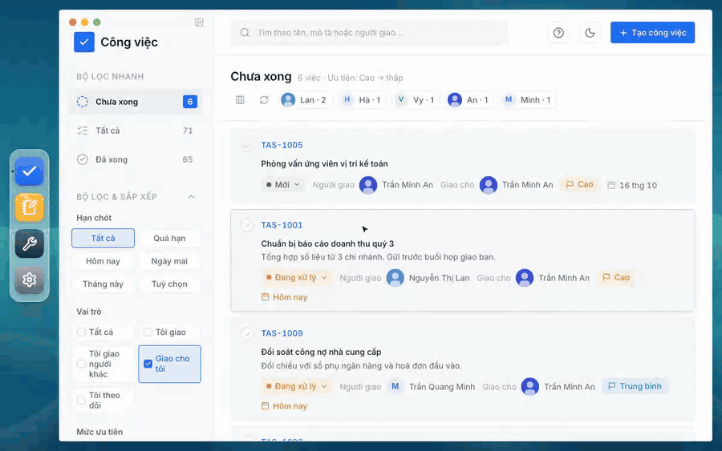

# Công việc — a desktop-style workspace app for Cogover

**English** · [Tiếng Việt](README.vi.md)

A single-page app that runs inside a [Cogover](https://cogover.com) Workspace as a **Custom Frontend Module**. It looks like a small desktop: a dock on the left and each app in its own window.



| App | What it does |
| --- | --- |
| **Công việc** (Tasks) | My tasks: quick filters, deadline / role / priority filters, filter by person, search, status workflow, rich-text description with pasted images, attachments, activity timeline with notes and @mentions, configurable and resizable columns. |
| **Ghi chú** (Notes) | Personal notes in folders: rich text, Markdown or plain text, tags, pins, sharing. |
| **Dev tools** | JSON formatter, Markdown preview, JWT decoder / encoder, Base64 decoder / encoder. Runs entirely in the browser; nothing is sent anywhere. |
| **Cài đặt** (Settings) | Personal settings (desktop wallpaper). |

The interface is in Vietnamese, and every date is computed in Vietnam time (UTC+7) whatever the browser's time zone.

## Try it locally (no Cogover account needed)

The dev server answers the Cogover API with a built-in mock backend and fictitious data.

```bash
cd app
npm install
npm run dev
```

Then open <http://localhost:5317>. To reset the mock data, open <http://localhost:5317/__mock/reset> (it answers with an empty page) and reload the app.

Requirements: Node.js 22.22 or newer (or 24.15+); the test tooling does not run on Node 20.

## Project layout

```
app/                  Vite + React 19 + TypeScript
  src/                Tasks app (root), plus:
    notes/            Notes app
    devtools/         Dev tools app
    settings/         Settings app
    desktop/          dock, windows, URL handling
    components/ui/    shadcn/ui components (Radix)
    workspaces.ts     Object / field IDs of the Workspace the page is served from
  dev/                mock backend used by `npm run dev` and the unit tests
e2e/                  Playwright end-to-end tests (mocked API)
objects/              the Cogover Objects and fields the apps need
CONTRACT.md           the detailed specification (Vietnamese only; the IDs in it are placeholders); code comments refer to its sections
```

Stack: React 19, TypeScript, Vite, Tailwind CSS v4, shadcn/ui on Radix, Plate (rich-text editor), Vitest, Playwright.

## Tests

```bash
# unit tests (app/)
cd app
npm run typecheck
npm run test:unit

# end-to-end tests against the built app with a mocked API (e2e/)
cd app && npm run build
cd ../e2e && npm install && npx playwright install chromium
npm run test:e2e:local
```

## Running it on your own Cogover Workspace

The app has no backend of its own: it calls the Workspace's Records API with the signed-in user's session.

1. Create the Objects and fields listed in [`objects/README.md`](objects/README.md).
2. Add a set with the IDs of your Workspace, Objects and fields to `app/src/workspaces.ts`, keyed by your hostname. Keep the example set: its placeholder IDs are the ones the local mock and the tests use. A hostname without a set of its own falls back to the example set, and every request then fails — so check the hostname you add.
3. Create a Custom Frontend Module project in your Workspace, copy `app/cogover.example.json` to `app/cogover.json` and fill in your Workspace URL, project ID and project slug, then build and publish with the Cogover Dev CLI (`@cogover/dev-cli`, already a dev dependency). The CLI asks for a Workspace API key the first time:

   ```bash
   cd app
   npm run build
   npx cogover-dev publish
   npx cogover-dev activate <version-id>
   ```

Dev tools works without any of this setup.

## Contributing

See [CONTRIBUTING.md](CONTRIBUTING.md) for the conventions of the code base.

## Acknowledgements

The components in `app/src/components/ui/` are adapted from [shadcn/ui](https://ui.shadcn.com) (MIT). The app also builds on Radix UI, Plate, Lucide icons and the Inter typeface (SIL Open Font License).

## License

[MIT](LICENSE) © Cogover LLC
